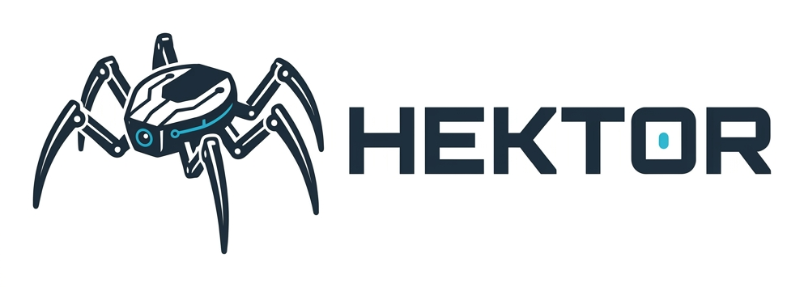

<p align="center"></p>

# hektor-micro-wakeword-esp32

**[Українською →](README.uk.md)**

How the wake word **«Гектор»** (*Hektor*) for a six-legged robot was built from scratch: synthetic and live data, feature generation, three [microWakeWord](https://github.com/OHF-Voice/micro-wake-word) training runs on a Colab T4, and a device-like evaluation on the author's own voice through the robot's microphone. This repository holds the **code, configs and results**. The model itself is published on Hugging Face:

**→ [MartynU/hektor-micro-wakeword-esp32](https://huggingface.co/MartynU/hektor-micro-wakeword-esp32)** (release `v1.0`, int8 TFLite for ESP32 / ESPHome `micro_wake_word`, 87 KB)

No audio, features or weights are in this repo (see [What is not published](#what-is-not-published)).

## Result

Three training runs, all re-scored on the same held-out test set. "Live" means the author saying «Гектор» to the robot, captured by the robot's INMP441 microphone and streamed over Wi-Fi, i.e. the real deployment path. Sliding window 5 (150 ms).

| Run | Cutoff | Live recall (n=22) | FA/h, dinner-party speech (5.3 h) | FA/h, robot room (14 min) | FA, negative clips (n=2146) |
|---|---|---|---|---|---|
| v1 baseline | 0.6 | 59.1 % (13/22) | 0.0 | 0.0 | 8.95 % |
| v2 push live recall | 0.5 | 72.7 % (16/22) | 42.6 | 4.3 | 38.82 % |
| **v3 → release v1.0** | **0.8** | **95.5 % (21/22)** | **1.5** | **0.0** | **4.15 %** |

Source: [`eval/results/v3/compare_v1_v2_v3.md`](eval/results/v3/compare_v1_v2_v3.md), full numbers for every group, cutoff and window in [`eval/results/v3/eval.json`](eval/results/v3/eval.json).

Before microWakeWord the project went through nine [openWakeWord](https://github.com/dscripka/openWakeWord) versions. They handled synthetic voices but not the author's live voice through the robot: the best of them (v4d) caught **41 %** of the same 22 live clips at a low 0.2 threshold (see the [model card](https://huggingface.co/MartynU/hektor-micro-wakeword-esp32)). The openWakeWord scripts are not in this repo; the research note that led to the switch is: [`train/research-2026-10-06.uk.md`](train/research-2026-10-06.uk.md).

Cutoff trade-off for v3 (window 5):

| Cutoff | Live recall | FA/h dinner party |
|---|---|---|
| 0.7 | 95.5 % | 3.7 |
| **0.8** | **95.5 %** | **1.5** |
| 0.9 | 90.9 % | 0.4 |
| 0.95 | 86.4 % | 0.0 |

Model: MixedNet, streaming, int8. 87 376 bytes of flash, 30.6 KB minimum tensor arena (33.8 KB in the manifest), about 39 k MAC per 30 ms step, 87 µs per inference on an x86 host. Compute on the ESP32-S3 is estimated from the MAC count, not yet measured on the chip.

## Using the model

The same model file works in two places.

### 1. In a Pipecat voice bot (tested)

This is how the robot runs today: the ESP32-S3 streams its microphone over WebRTC and the model runs on the host,
in front of STT. All numbers above were measured on this path.
[`examples/pipecat/wake_gate.py`](examples/pipecat/wake_gate.py) is a `FrameProcessor` that lets audio through
only after «Гектор», keeps 300 ms before the word so the command is not cut, and closes after 20 s of silence.

```python
from wake_gate import WakeGate, load_hektor   # pip install pipecat-ai pymicro-wakeword huggingface_hub

pipeline = Pipeline([
    transport.input(),             # 16 kHz mono: PipelineParams(audio_in_sample_rate=16000)
    WakeGate(load_hektor()),       # downloads the model from Hugging Face, tag v1.0
    stt,
    context_aggregator.user(),
    llm,
    tts,
    transport.output(),
    context_aggregator.assistant(),
])
```

### 2. On the ESP32 itself (not yet verified)

The model is an int8 streaming TFLite Micro network built for the chip, and its `manifest.json` follows the
ESPHome `micro_wake_word` format:

```yaml
micro_wake_word:
  models:
    - model: https://huggingface.co/MartynU/hektor-micro-wakeword-esp32/resolve/main/manifest.json
```

The author has not run it on the chip yet: memory comes from the model, compute is estimated from the MAC count.
An on-device example for ESP-IDF with timing measured on an ESP32-S3 is planned for v1.1.

## Pipeline

```
data/      clips: TTS (Piper, Gemini, Cartesia, ElevenLabs), voice clones (FireRedTTS3),
           tempo augmentation, live recordings through the robot, provenance manifest
   │
train/     prepare.py  split by voice, never by file  →  dataset.zip
           prep_*.py   format check, DC removal, 5 ms fades, train/val/test folders
           gen_*.py    background corpora (MIT RIR, AudioSet, FMA) + augmented spectrograms
           train_*.py  training_parameters.yaml → microwakeword.model_train_eval → int8 .tflite
   │
eval/      evaluate.py / eval_v3.py: device-like streaming evaluation, FA/h on DiPCo and on the room
   │
record/    Pipecat bots that listen through the robot's ears: re-record clips, record live
           «Гектор», run a live test of several models at once
```

### Data (`data/`)

Every clip has a provenance record in `manifest.json`: source, model, voice, phrase, text, duration, date, and for robot recordings distance, position and the Whisper check. [`data/manifest.example.json`](data/manifest.example.json) keeps 16 of the 69 380 records as a format example.

- `gen_piper.py` — bulk Ukrainian TTS with Piper (7 Ukrainian speakers + a few Russian ones for a hard [ɡ]), random tempo and prosody per clip; also the near-homophone and everyday-phrase negatives.
- `gen_gemini.py`, `import_cartesia.py` — cloud TTS positives with emotions; `gen_negative_cartesia.py` — negatives in the same voices.
- `gen_firered.py` — zero-shot clones of the author's voice (FireRedTTS3) from references cut by `make_refs.py`.
- `aug_tempo.py` — 0.6×, 0.72×, 0.85× time-stretch, because live «Гектор» lasts 0.5–0.7 s and TTS 0.8–1.2 s.
- `cut_speech.py` — a long recording of the author's speech cut into word-level negatives by Whisper timestamps.
- `whisper_check.py` — every robot-mic positive is checked by Whisper; clips where the word is not audible are not trained on.
- `merge_inbox.py` — merge batches from other generators into the manifest.

### Training (`train/`)

The microWakeWord notebook rewritten as scripts, with the Colab workarounds documented in [`train/TRAINING.uk.md`](train/TRAINING.uk.md) (Ukrainian). The v3 run, which became the release:

- positives: about 10.3 k training clips of «Гектор», «Гекторе» and «Гектор, <command>», including 70 live recordings; live clips make up about 10 % of positive draws with a 3× loss penalty;
- negatives: about 10.5 k own clips plus the precomputed `speech`, `dinner_party` and `no_speech` spectrograms from [`kahrendt/microwakeword`](https://huggingface.co/datasets/kahrendt/microwakeword);
- augmentation: background SNR −5…20 dB, room impulse responses, a −70…−50 dBFS noise floor instead of digital silence, SpecAugment 2×5 in time and frequency;
- 10 000 steps, batch 128, lr 0.001, class weights 1.5 / 1.0; checkpoint chosen for ≤ 0.5 false accepts per hour on room ambient + 1 h of dinner-party speech, then for maximum recall; 38 minutes on a T4.

Per-run configs as they were executed: [`train/configs/v1..v3/`](train/configs/) (`training_parameters.yaml`, resolved config, model summary, data counts).

### Evaluation (`eval/`)

`evaluate.py` copies what the chip does: 1 s of −60 dBFS noise + clip + 0.5 s → micro-frontend (40 mel bins, 30 ms window, 10 ms step) → streaming int8 model, 3 frames per call → sliding average of the last N outputs → detection if the average crosses the cutoff. False accepts per hour come from streaming 5.3 h of DiPCo dinner-party conversation (one trigger per rising edge, 1 s refractory) and 14 min of the robot's room recorded through its own ears. Results for every run live in [`eval/results/`](eval/results/).

### Recording through the robot (`record/`)

`record.py` is a Pipecat bot that only listens to the robot's ears and saves audio between HTTP start/stop marks. `rerecord.py` plays dataset clips through a speaker and labels what the robot heard; the same client records live «Гектор» from the author. `live.py` scores several models at once on the live stream and prints a verdict per utterance. The transport, firmware and the rest of the robot are in the main project (private).

## What the three runs taught

1. **Synthetic voices are not enough.** v1 was fine on TTS and caught 59 % of live clips. The gap is the microphone chain, the distance and real fast speech.
2. **Removing negatives and validating on silence is a trap.** v2 dropped the Piper negatives and picked the checkpoint by false accepts on a quiet room. Live recall went up, false accepts on conversation went from 0 to 42 per hour.
3. **More real data plus a balanced validation set is what worked.** v3 added 93 live recordings (70 train, 23 test), restored the negatives, added 347 hard negatives and validated on room noise *and* dinner-party speech at the same time.

## Limitations

- Speaker-dependent: the live test set is one speaker, 22 clips. Recall on unseen synthetic voices is 62 % at the release cutoff, 34 % on cloud TTS voices.
- «Гектор» is harder than «Гекторе» (55 % vs 78 % on held-out synthetic voices at 0.8).
- The room-ambient figure comes from 14 minutes of audio.
- On-chip timing is estimated from MACs; the robot currently runs the model on the host via `pymicro-wakeword` on audio streamed from the ESP32-S3.

## Reproducing

The scripts are a record of how the model was made, not a turnkey trainer: the raw audio is private, so you need your own clips in the same layout. The flow for one run, with `HK_WORK` as the work directory (defaults to `./work`):

```bash
pip install -r train/requirements.txt    # plus microWakeWord @4665173, see the file
export HK_WORK=$PWD/work HF_TOKEN=...    # HF_TOKEN only if you push artifacts to your own Hub repo
python train/prepare.py --zip            # manifest.json → dataset.zip, split by voice
#   put dataset.zip + manifest.json into $HK_WORK/raw/micro-wake-hector-v3/
python train/prep_v3.py                  # clean clips → $HK_WORK/data/...
python train/gen_v3.py                   # corpora + augmented spectrograms → $HK_WORK/features/
python train/dp1h.py                     # 1 h DiPCo validation subset (Colab RAM workaround)
python train/train_v3.py --steps 10000   # → $HK_WORK/trained/v3/...stream_state_internal_quant.tflite
python eval/eval_v3.py --tflite $HK_WORK/trained/v3/tflite_stream_state_internal_quant/stream_state_internal_quant.tflite --out $HK_WORK/trained/v3/eval.json
python train/publish_v3.py               # manifest.json, tables, upload
```

Every script with `argparse` answers `--help`. `data/` and `record/` have their own requirements (`data/requirements.txt`, `record/pyproject.toml`).

## What is not published

- Audio: TTS clips, re-recordings and live recordings of the author, room background. The negative spectrograms from `kahrendt/microwakeword` are CC BY-NC 4.0.
- Features (`.npy`, mmap), checkpoints, ONNX and TFLite weights. The released model is on Hugging Face under CC BY-NC 4.0 because of those negatives.
- API keys (Gemini, Cartesia, ElevenLabs, Hugging Face): the scripts read them from the environment.

## Credits

[microWakeWord](https://github.com/OHF-Voice/micro-wake-word) by Kevin Ahrendt and its [negative datasets](https://huggingface.co/datasets/kahrendt/microwakeword); [microwakeword-trainer](https://github.com/interkelstar/microwakeword-trainer) for the augmentation ideas (SNR range, noise floor, SpecAugment, class weights); [pymicro-features](https://github.com/rhasspy/pymicro-features) and [pymicro-wakeword](https://github.com/OHF-Voice/pymicro-wakeword); [Piper](https://github.com/rhasspy/piper); [FireRedTTS3](https://github.com/FireRedTeam/FireRedTTS); [openWakeWord](https://github.com/dscripka/openWakeWord); MIT RIR, AudioSet, FMA and DiPCo corpora; [Pipecat](https://github.com/pipecat-ai/pipecat) for the robot transport; Whisper via `mlx-whisper`.

The code was written by Martyn together with Claude (Anthropic) as a pair-programmer: the goals, the data decisions, the listening and the robot are the author's; much of the code was drafted with Claude, then run, debugged and re-run by the author. Code comments are in Ukrainian and left as they were.

## License

Code: [MIT](LICENSE). The model and the data have their own terms (see above).
